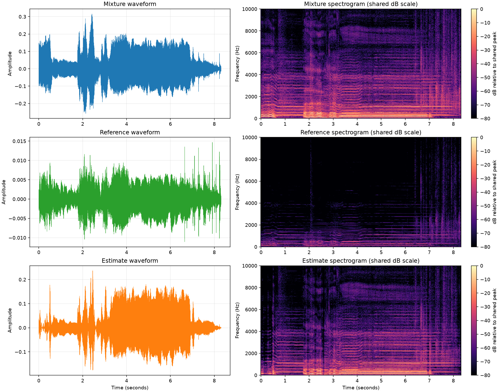

# Mridangam Output Quality Check

This is a diagnostic check of the existing files only. It does not certify that the estimate is perceptually or scientifically good.

## File checks

All three WAVs decoded successfully with `soundfile`; each is finite-valued, mono, 44.1 kHz and aligned to the same 366,253 samples (8.305 seconds).

| Audio | Path | Sample rate (Hz) | Channels | Samples | Duration (s) | Peak abs. amplitude | RMS | Silent? | Samples at abs(amplitude) >= 0.999 |
|---|---|---:|---:|---:|---:|---:|---:|---|---:|
| Mixture | `D:\indian-instrument-separation\outputs\mridangam_mixture.wav` | 44,100 | 1 | 366,253 | 8.305 | 0.315633 | 0.054987 | No | 0 |
| Reference | `D:\indian-instrument-separation\outputs\mridangam_reference.wav` | 44,100 | 1 | 366,253 | 8.305 | 0.014692 | 0.002497 | No | 0 |
| Estimate | `D:\indian-instrument-separation\outputs\mridangam_separated.wav` | 44,100 | 1 | 366,253 | 8.305 | 0.236887 | 0.043202 | No | 0 |

The clipping check counts samples at or above 0.999 (float full scale). It is a simple digital-peak check; it cannot identify clipping already present in the source recording. No samples reached 0.999; no full-scale clipping was detected by this check.
None are silent under the stated peak/RMS threshold.

The reference is much quieter in absolute level than the other files: the mixture RMS is about 22.0 times the reference RMS, and the estimate RMS is about 17.3 times the reference RMS. SI-SDR is scale-invariant, so its score does not penalize this loudness mismatch. This level difference is an additional reason not to interpret the SI-SDR gain as clean separation.

## Matched SI-SDR comparison

Using the same mean-removed, scale-invariant SI-SDR calculation as `src/run_saraga_mridangam_demo.py`, both the input mixture and estimate were compared to the same aligned reference:

- Mixture vs reference: **-8.75 dB**
- Estimate vs reference: **-7.09 dB**
- Change (estimate minus mixture): **+1.66 dB**

A positive change means the estimate is numerically closer by this SI-SDR measure for this short held-out segment. It is a modest result, not proof of clean separation; the scores are from one recording and do not establish generalization or perceptual quality.

## Comparison plot

The waveform panels show the full aligned segment. Spectrograms use the same SciPy STFT settings (`nperseg=2048`, `noverlap=1024`), frequency range, and dB scale. The reference appears faint on this shared scale because its absolute level is much lower. A plot can reveal timing, energy, and broad spectral differences but cannot by itself confirm instrument isolation.

## Listening in VS Code

Open each linked WAV in VS Code or the system audio player. The HTML controls below do not autoplay; use Play when ready.

- [Mixture WAV](mridangam_mixture.wav)
- [Reference WAV](mridangam_reference.wav)
- [Estimate WAV](mridangam_separated.wav)

<audio controls preload="none" src="mridangam_mixture.wav">Mixture audio: mridangam_mixture.wav</audio>
<audio controls preload="none" src="mridangam_reference.wav">Reference audio: mridangam_reference.wav</audio>
<audio controls preload="none" src="mridangam_separated.wav">Estimate audio: mridangam_separated.wav</audio>

## Interpretation and next useful step

The estimate is numerically closer by SI-SDR by 1.66 dB, but it remains much louder than the reference. Neither that modest gain nor exact waveform length means the mridangam has been cleanly separated. The most useful next step is a focused listening comparison of these three matched files, using the reference to identify what the current estimate misses, before changing the method.
